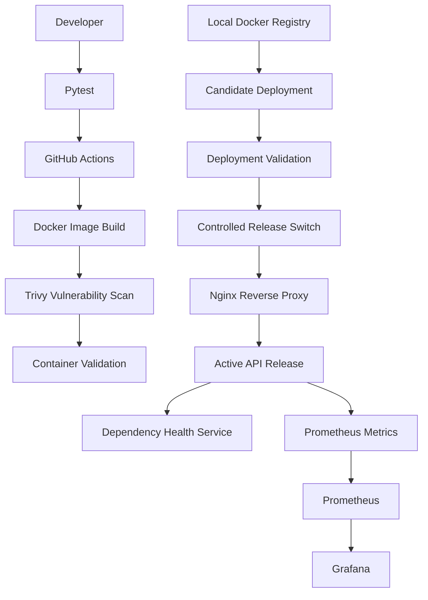

# Production Delivery Platform (PDP)

[](https://github.com/Yashu270319/production-delivery-platform/actions/workflows/ci.yml)

A locally deployable production-delivery and release-engineering platform built to demonstrate containerized application delivery, CI validation, controlled releases, traffic switching, rollback, and observability.

PDP uses Docker, FastAPI, GitHub Actions, a local container registry, Nginx, Prometheus, and Grafana. It demonstrates practical operational workflows without depending on paid cloud infrastructure.

## Project Objectives

The platform demonstrates an application delivery lifecycle:

- Automated application testing and container validation.
- Container image construction and vulnerability scanning.
- Versioned image storage in a local registry.
- Candidate deployment and pre-release validation.
- Controlled Nginx traffic switching.
- Live release verification.
- Recovery to a previous release after failed verification.
- Dependency-aware health checks and Prometheus instrumentation.

The emphasis is on deployment correctness, operational safety, and failure recovery rather than simply running an application inside a container.

## Architecture



## Implemented Capabilities

### 1. Application and Container Engineering

- FastAPI service with explicit API endpoints.
- Python 3.12 slim container image.
- Multi-stage Docker build.
- Non-root application execution using UID/GID `10001`.
- Build-time application version injection.
- Docker health check based on application liveness.

### 2. Application Health and Dependency Validation

| Endpoint | Purpose |
|---|---|
| `/` | Service identity |
| `/health/live` | Process liveness |
| `/health/ready` | Dependency-aware readiness |
| `/version` | Deployed application version |
| `/dependency-check` | Dependency availability |
| `/metrics` | Prometheus metrics |

Liveness and readiness are deliberately separate. A running application process can remain alive while a required dependency is unavailable. In that situation, readiness returns HTTP 503.

### 3. Continuous Integration

GitHub Actions runs two validation jobs:

- **API tests:** installs Python dependencies and executes the pytest suite.
- **Container validation:** builds the Docker image, scans it with Trivy, starts the API alongside a test dependency, and validates the running deployment.

Container validation checks liveness, the expected application version, and readiness.

The CI workflow validates the image and deployment. It does not automatically publish an image to the local registry or deploy to a production environment.

### 4. Versioned Deployment and Release Management

The managed release workflow separates candidate deployment from live traffic switching.

**Candidate deployment:**

1. Check that the requested version exists in the local registry.
2. Pull the versioned image.
3. Start a candidate container on its assigned host port.
4. Validate liveness, version, and readiness.
5. Remove the newly created container if validation fails.

**Traffic switching:**

1. Confirm that the candidate container is running.
2. Validate the candidate directly.
3. Back up the existing Nginx upstream configuration.
4. Atomically replace the active upstream configuration.
5. Test and reload Nginx.
6. Verify the application version through the live proxy.
7. Attempt to restore the previous upstream if verification fails.

The previous release is kept available so traffic can be switched back.

### 5. Observability

- Prometheus scrapes API metrics through the Nginx proxy.
- HTTP request counters are labelled by method, endpoint, and status code.
- Request-duration histograms are exposed.
- Grafana provides the visualization layer.
- Prometheus uses a three-day local retention period.

The current implementation demonstrates metrics collection and visualization. Monitoring-triggered rollback and alert delivery are not implemented.

## Technology Stack

| Area | Technologies |
|---|---|
| Application | Python, FastAPI |
| Testing | Pytest, FastAPI TestClient |
| Containerization | Docker, Docker Compose |
| CI/CD | GitHub Actions |
| Image security | Trivy |
| Image storage | Local Docker Registry |
| Reverse proxy | Nginx |
| Monitoring | Prometheus |
| Visualization | Grafana |
| Scripting | Bash |
| Version control | Git, GitHub |

## Run the Development API

### Requirements

- Linux
- Git
- Python 3.12
- Docker Engine
- Docker Compose

Clone the repository:

```bash
git clone https://github.com/Yashu270319/production-delivery-platform.git
cd production-delivery-platform
```

Create a virtual environment and install dependencies:

```bash
python3 -m venv .venv
source .venv/bin/activate
python -m pip install -r requirements.txt
```

Run the automated tests:

```bash
python -m pytest -q
```

Build and start the development API:

```bash
docker compose -f compose/compose.yaml up -d --build
```

Inspect the container:

```bash
docker compose -f compose/compose.yaml ps
```

Test the endpoints:

```bash
curl -fsS http://127.0.0.1:8000/
curl -fsS http://127.0.0.1:8000/health/live
curl -fsS http://127.0.0.1:8000/health/ready
curl -fsS http://127.0.0.1:8000/version
curl -fsS http://127.0.0.1:8000/metrics
```

Stop the development stack:

```bash
docker compose -f compose/compose.yaml down
```

This Compose workflow runs the development API. It is separate from the managed release environment documented in the release runbook.

## Release Operations

The managed release environment uses:

| Component | Host endpoint |
|---|---|
| Local image registry | `127.0.0.1:5000` |
| Existing release `1.0.1` | `127.0.0.1:8001` |
| Managed release `1.0.0` | `127.0.0.1:8002` |
| Candidate release `1.0.2` | `127.0.0.1:8003` |
| Nginx entry point | `127.0.0.1:8080` |

The traffic-switch script currently supports versions `1.0.0`, `1.0.1`, and `1.0.2`.

See [Release and Rollback Runbook](docs/RELEASE-AND-ROLLBACK.md) for operational checks, candidate deployment, traffic switching, and rollback procedures.

## Failure Exercises and Incident Reports

The project includes documented failure scenarios:

- [INC-001: CI readiness validation failure](docs/incidents/INC-001-ci-readiness-validation-failure.md) — investigates a CI deployment failure caused by a missing dependency in the test environment.
- [INC-002: Dependency failure and recovery](docs/incidents/INC-002-dependency-failure-and-recovery.md) — demonstrates readiness degradation during dependency failure and recovery after the dependency restarts.

These exercises distinguish application liveness from dependency-aware readiness and document the evidence collected during recovery.

## Automated Release-Switch Tests

The release-switch script has automated tests covering:

- Rejection of unsupported release versions.
- Preservation of the previous Nginx backend when a candidate configuration fails validation.

Run them with:

```bash
python -m unittest tests.test_switch_release -v
```

These tests use a temporary test environment and mocked Docker commands. They do not modify the live release environment.

## Documentation

- [Release and Rollback Runbook](docs/RELEASE-AND-ROLLBACK.md)
- [Incident 001 — CI Readiness Validation Failure](docs/incidents/INC-001-ci-readiness-validation-failure.md)
- [Incident 002 — Dependency Failure and Recovery](docs/incidents/INC-002-dependency-failure-and-recovery.md)

## Current Scope and Limitations

PDP is a local engineering and learning environment, not a production-hardened deployment service.

Current limitations include:

- No high-availability architecture.
- No monitoring-triggered automatic rollback.
- No configured alert-delivery workflow.
- No durable release-history service.
- No managed cloud deployment.
- Release switching depends on the previous release remaining available.

The project demonstrates practical delivery and reliability engineering concepts while making these limitations explicit.

## Future Work

- Add measurable service-level indicators and objectives.
- Configure and test actionable monitoring alerts.
- Automate dependency-failure and recovery exercises.
- Improve release audit history and deployment evidence.
- Introduce a local Kubernetes deployment and rollout workflow after the current release platform is fully documented.
